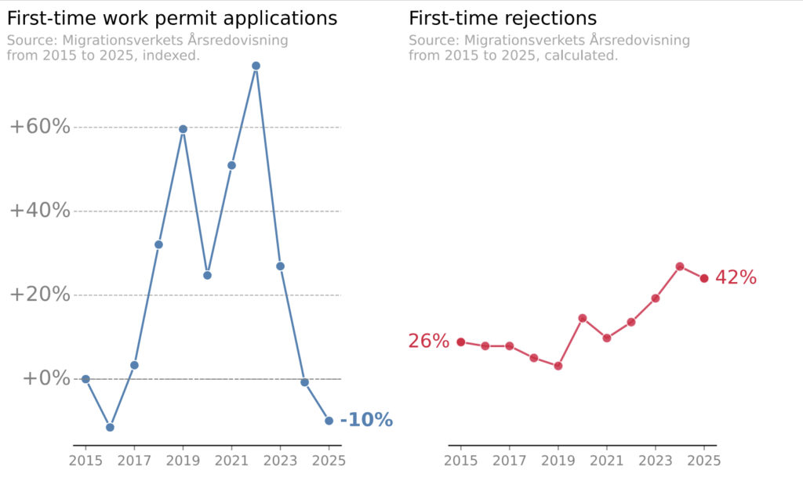
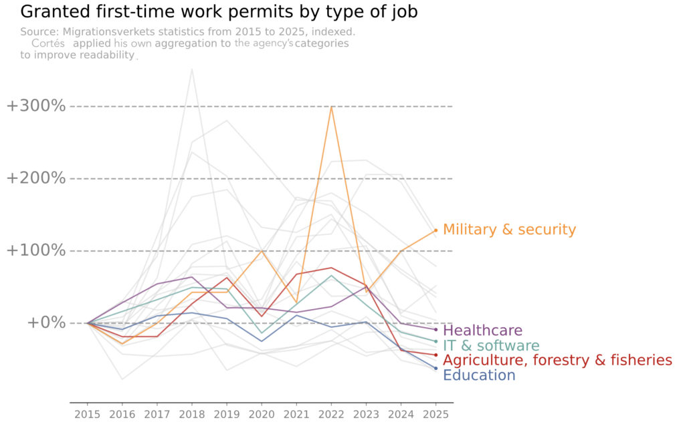

<!-- prettier-ignore -->
|  |  |
| :---- | :---- |
| **Författare** | Eric Peterson |
| **Uppdaterad** | 8 okt 2026 |
| **Status** | Åtgärder pågår |
| **Konsekvenser** | Över 100 000 pågående medborgarskapsärenden prövas enligt krav som infördes efter att ansökningarna lämnades in. Handläggningstider på närmare 5 år[^1]. Avslagen fortsätter. |
| **Varaktighet** | I kraft sedan den 6 juni 2026; pågår fortfarande |
| **Är du berörd?** | [Fair Transition][fair-transition] samordnar juridiska och politiska insatser |

**Hoppa till:** [Sammanfattning](#sammanfattning) · [Konsekvenser](#konsekvenser) · [Händelseförlopp](#handelseforlopp) · [Försök att begränsa skadan](#forsok-att-begransa-skadan) · [Rotorsaksanalys](#rotorsaksanalys) · [Bra, dåligt och tur](#vad-som-gick-bra-vad-som-gick-daligt-och-var-vi-hade-tur) · [Åtgärder och nästa steg](#atgarder-och-nasta-steg) · [Lärdomar](#lardomar) · [Bilaga](#bilaga) · [Centrala dokument](#centrala-dokument)

## Sammanfattning

Den 29 april 2026 satt jag på åhörarläktaren i riksdagen och såg ett förslag falla med en enda röst. Hade det gått igenom hade de över 100 000 personer som redan väntade på medborgarskap, jag bland dem, sluppit de nya, strängare reglerna. Först några timmar senare, när jag satt och tröståt på Taco Bell (jag kände mig mer amerikansk än svensk just då), fick jag veta varför det föll: två riksdagsledamöter från Sverigedemokraterna hade brutit mot en hundraårig parlamentarisk praxis och röstat trots att de hade lovat att inte göra det.

Lagen trädde i kraft den 6 juni. Den höjde bland annat hemvistkravet från fem till åtta år och införde krav på självförsörjning och på kunskaper i svenska och samhällskunskap. Den antogs dessutom utan övergångsbestämmelser, alltså regler som hade låtit redan inlämnade ansökningar prövas enligt de gamla kraven. I mjukvarutermer saknades en ”migreringsväg”. Därför gäller lagen [alla som redan står i kön][queue-passes-100k], och ansökningar som lämnades in under de gamla kraven [får nu avslag][rejections-exceed-approvals] enligt de nya.

Den här texten är skriven som en [postmortem][sre-postmortem-culture] – en efterhandsanalys av det slag som mjukvaruteam gör efter en driftstörning. Här granskar jag två försök att ändra utfallet: mitt eget ekonomiska argument mot reformen, som jag förde i ett remissvar 2025, och kampanjen för övergångsbestämmelser, som bara var en röst från att lyckas. [Lärdomarna](#lardomar) i slutet riktar sig till alla som står inför liknande reformer i andra länder.

En vald regering med stöd av en riksdagsmajoritet har förstås rätt att skärpa reglerna för medborgarskap. Men en legitim förändring kan ändå vara kostsam, och ett mandat för strängare regler är inte självklart ett mandat att tillämpa dem på redan inlämnade ansökningar[^2].

### Viktigaste slutsatser

- **En koalition beroende av Sverigedemokraterna prioriterade sin egen stabilitet framför argument byggda på den ekonomiska filosofi den själv företrädde**. De borgerliga regeringspartierna framhöll under hela mandatperioden kvalificerad arbetskraftsinvandring som en prioriterad fråga. Mitt ekonomiska argument byggde på just det målet, men ingen av dem ändrade hållning före omröstningen. Sammanhållningen i koalitionen vägde tyngre.
- **Ett smalt krav var en röst från att lyckas, medan ett brett inte rubbade någon**. Eftersom kravet bara gällde övergångsbestämmelser kunde en majoritet bildas utanför regeringen när förutsättningarna förändrades. Och mejlen till politiska vildar, som såg chanslösa ut, gav utdelning när två av dem bytte sida.
- **Det verkliga beslutet fattades långt innan den offentliga debatten började**. Ett koalitionsavtal som undertecknades 2022 band regeringen vid en i detalj fastlagd medborgarskapsreform innan något förslag gick ut på remiss.
- **Arbetskraftsinvandrare saknar en egen intresseorganisation**. Fack och arbetsgivarorganisationer bevakar var sin del av deras intressen, men ingen av dem talar fullt ut för det gemensamma behovet av förutsägbarhet. Luckan har bestått genom flera regeringar och försätter insatser som min i ett strukturellt underläge.

<small>[↑ Till toppen](#top)</small>

## Konsekvenser

I Sverige går den typiska vägen för en arbetskraftsinvandrare eller forskare från tillfälliga tillstånd till permanent uppehållstillstånd till medborgarskap. Varje status[^3] före medborgarskapet är villkorad: en uppsägning, en lågkonjunktur eller en lagändring kan avsluta den. Först med medborgarskapet är den risken helt borta. Därför har villkoren för att bli medborgare, och framför allt hur lång tid det tar, betydelse för människor långt innan de själva kan ansöka.

Krig i vårt närområde, stormaktsrivalitet och demokratisk tillbakagång i tidigare stabila demokratier har på senare år gjort medborgarskapets trygghet mer värdefull och dess frånvaro mer kostsam.

För de över 100 000 personer som berörs innebär den nya lagen:

- **Livet på paus**. Människor som planerat boende, karriär och annat utifrån fem år står nu inför åtta, plus krav på språk och samhällskunskap som staten ännu inte fullt ut kan testa.
- **Begränsat resande**. Tid utomlands kan försena medborgarskapet ytterligare. Om till exempel en sjuk förälder behöver omsorg blir det en smärtsam kalkyl.
- **Ingen rörlighet inom EU**. För medborgare från länder utanför EU är svenskt medborgarskap också EU-medborgarskap.
- **Ingen representation nationellt eller i EU**. Bara medborgare får rösta i riksdagsval och i val till Europaparlamentet.
- **Förlorad tillhörighet och tillit**. Ett avslag från Migrationsverket är en påfrestande upplevelse: ett brev från staten som formellt nekar en tillhörighet. Sverige har i praktiken lagt tiotusentals sådana brev på kö, redo att skickas ut i en jämn ström.

<small>[↑ Till toppen](#top)</small>

## Händelseförlopp

Konsekvenserna utvecklades i fem faser.

<!-- prettier-ignore -->
| Fas | När | Vad som hände |
| :---- | :---- | :---- |
| Latent fel | Okt 2022 | Tidöavtalet mellan de tre borgerliga regeringspartierna (M, KD och L) och SD binder koalitionen vid skärpta krav för medborgarskap |
| Försämring | 2025–2026 | Efter en offentlig strid inom koalitionen om att pausa medborgarskap införs utökade säkerhetskontroller, som så småningom driver kön förbi 100 000 ärenden; handläggningstiden (75:e percentilen) stiger till närmare 5 år |
| Ändringen godkänns | 29 apr 2026 | Riksdagen antar propositionen med 258–33; oppositionens förslag om övergångsbestämmelser faller med 147–146 |
| Driftsättning | 6 jun 2026 | Lagen träder i kraft utan övergångsbestämmelser |
| Pågående påverkan | Jun 2026 och framåt | Pågående ärenden prövas och får avslag enligt de nya kraven |

<small>[↑ Till toppen](#top)</small>

## Försök att begränsa skadan

### Spår A: det ekonomiska argumentet

Jag flyttade till Sverige i september 2020 för att arbeta inom tech. Valet byggde delvis på ett kalkylblad jag hade gjort för att utvärdera och rangordna tänkbara länder. Lön och karriärmöjligheter fanns med, men också tid till permanent uppehållstillstånd, tid till medborgarskap, språkfaktorer och demokratiindex. Stabilitet och förutsägbarhet var uttryckliga kriterier.

Det är inte unikt för mig. Andrew Stetsenko, som i 15 år har hjälpt techarbetare till jobb utomlands via relocate.me, [konstaterade i april 2026][relocateme-substack] (på engelska) att beslut om att flytta numera styrs mer av stabilitet och livskvalitet än av lön och karriär. Svenska arbetsgivare har [länge rapporterat][techsverige-report] att de inte hittar den kvalificerade arbetskraft de behöver, särskilt inom tech.

Innan regeringen lägger fram en proposition tillsätter den oftast en utredning. Utredningens förslag publiceras och skickas ut på remiss. För den som kommer från mjukvaruvärlden liknar remissen en RFC: vem som helst får svara, även enskilda personer och grupper som regeringen inte har bjudit in.

Utredningens förslag ([SOU 2025:1][sou-2025-1]) gick ut på remiss i januari 2025. Till skillnad från den slutliga propositionen innehöll det övergångsbestämmelser och ett måttligt inkomstkrav motsvarande förbehållsbeloppet, omkring 6 700 kronor i månaden. Båda hamnade snart under tryck: den 4 februari sa migrationsminister Johan Forssell (M) till SvD att han ville gå längre än utredaren och, som tidningen sammanfattade det, [”skippa övergångsregler”][forssell-skip-transitional-rules][^4]. Den 20 mars kom sedan en [promemoria med kompletterande förslag][supplementary-proposal] som nästan tredubblade inkomstkravet, till tre inkomstbasbelopp eller drygt 20 000 kronor i månaden.

Samtidigt hade regeringen gett Migrationsverket i uppdrag att skärpa säkerhetskontrollerna av medborgarskapsansökningar. För den engelskspråkiga nyhetssajten [The Local][minister-reassures-labor-migrants] försäkrade Forssell att kontrollerna varken skulle bromsa handläggningen eller påverka arbetskraftsinvandrare. I slutändan tog handläggningen längre tid för alla.

Jag oroade mig för att den stabilitet som en gång lockat mig till Sverige höll på att försvinna, och ingen tycktes göra något åt det. Det fick mig att agera. Omkring den 24 mars började jag skicka runt ett utkast till brev bland invandrade vänner och kollegor, och en vecka senare lämnade jag in [det här remissvaret][my-remiss-response-in-swedish] till Justitiedepartementet, undertecknat av 379 utlandsfödda i techbranschen, från vanliga anställda till grundare, chefer och investerare.

I mitt remissvar hävdade jag att det längre hemvistkravet, de nya språkkraven och självförsörjningskravet skulle sudda ut Sveriges försprång i konkurrensen om kvalificerad arbetskraft. För någon som är direkt berörd var sambandet självklart: när ett land försämrar villkoren väljer färre att komma, och när det tillämpar de försämrade villkoren på människor som redan är halvvägs genom processen kommer en del av dem att välja att lämna. Svaret avslutades med en uppmaning att införa övergångsbestämmelser. Jag förde ett ekonomiskt argument eftersom det var det jag kunde föra med trovärdighet, och eftersom regeringspartierna sa att det var något de brydde sig om. Lagen gör förstås ingen åtskillnad: alla i kön, oavsett vilken väg de kom till Sverige, prövas enligt de nya reglerna.

Underskrifterna gav svaret en legitimitet som mina synpunkter ensamma hade saknat. Det ledde så småningom till [en debattartikel i Svenska Dagbladet][svd-op-ed] (SvD) i maj 2025, en publicerad [replik på migrationsministerns egen debattartikel][svd-reply-to-minister] i augusti samma år (han svarade inte), möten med politiker och politiskt sakkunniga, samtal med chefer och investerare i techbranschen samt intervjuer i en rad andra medier.

Ingenting av detta gav någon synlig förändring i något regeringspartis hållning före omröstningen.

Argumentet nämndes åtminstone i regeringens proposition. I [prop. 2025/26:175][prop-2025-26-175] står att ”flera privatpersoner anför bl.a. att en skärpning av hemvistkravet riskerar att leda till att personer väljer bort den svenska arbetsmarknaden till förmån för andra länder med mer förmånliga medborgarskapsregler, vilket kan leda till att Sverige går miste om värdefull kompetens”[^5]. Men propositionen bemöter inte den invändningen någonstans i texten.

Det finns tecken på att argumentet gick fram, bara inte i tid. Inom två veckor efter att propositionen nått riksdagen [föreslog Centerpartiet ett snabbspår][center-party-fast-track] till medborgarskap för den som betalat en viss summa i skatt, och gjorde det senare till en central del av sin valkampanj 2026. I augusti föreslog Forssells eget parti, Moderaterna, [ett eget snabbspår][moderate-fast-track]: medborgarskap efter fem år i stället för åtta för ”talanger”.

### Spår B: det rättighetsbaserade argumentet

Det andra spåret byggde på grundläggande rättigheter och begärde mycket mindre: behåll de skärpta kraven, men tillämpa dem inte på redan inlämnade ansökningar, oavsett hur den sökande kom till Sverige. Det har sina rötter i en separat [namninsamling][signature-campaign] för övergångsbestämmelser som Patrick Gallen startade 2025, men samlades kring kampanjen [Fair Transition][fair-transition], som bildades i februari 2026. Ungefär samtidigt [riktade Lagrådet hård kritik][lagradet-opinion] mot lagförslaget för att det stred mot rättssäkerhetens principer. Lagrådets yttranden är dock inte bindande.

Fair Transition arbetade med samma verktyg som de flesta decentraliserade gräsrotskampanjer: sociala medier, pressmeddelanden, intervjuer och direktkontakt med riksdagsledamöter över blockgränsen. I centrum fanns en kaotisk gruppchatt som till slut växte till över tusen medlemmar, där frivilliga föreslog och genomförde idéer mellan politiska kommentarer och rop på hjälp.

Delvis sporrade av Fair Transitions arbete fick Annika Hirvonen (MP) och Niels Paarup-Petersen (C) i början av april de fyra sällan eniga oppositionspartierna att ställa sig bakom[^7] övergångsbestämmelser. Då återstod den till synes omöjliga uppgiften att vinna två röster till i en riksdag där strikt partidisciplin är norm.

Samtidigt hade Liberalerna, som låg illa till i opinionen inför valet, [gjort en helomvändning][liberals-accept-sd-ministers] och öppnat för sverigedemokratiska ministrar efter valet. För ett parti med rättsstaten som en av sina grundpelare utlöste beslutet en intern revolt, som antydde att några liberala ledamöter kunde bryta partilinjen. De flesta av Fair Transitions frivilliga fokuserade på dem. En mindre grupp mejlade nio politiska vildar.

Till slut bytte de tidigare sverigedemokraterna Katja Nyberg och Elsa Widding sida och röstade för övergångsbestämmelser. Nyberg [angav senare rättssäkerheten och de mejl hon fått][nyberg-op-ed] som skäl. Det borde ha gett övergångsbestämmelserna majoritet.

Men riksdagen bygger på kvittning, en ordning som funnits i närmare hundra år: inför varje mandatperiod kommer partierna överens om att kvitta frånvarande ledamöter mot varandra över blockgränsen, så att omröstningarna speglar mandatfördelningen. Två sverigedemokrater, Michael Rubbestad och Charlotte Quensel, var utkvittade men röstade ändå, och tog därmed ut vildarnas röster. [Oppositionens förslag föll][transitional-rules-fail] (på engelska) med 147–146. Att bryta kvittningsavtalet var [utan motstycke][pairing-break-unprecedented].

Oppositionen försökte två gånger tvinga fram en ny omröstning, först genom ett utskottsinitiativ och sedan genom en motion med anledning av en händelse av större vikt. Båda misslyckades, det andra när talmannen, [med kammarens stöd][speaker-upholds-ruling], slog fast att ett brutet kvittningsavtal inte motiverade någon ny omröstning. Lagen trädde i kraft den 6 juni utan övergångsbestämmelser.

<small>[↑ Till toppen](#top)</small>

## Rotorsaksanalys

Inget av de två spåren övertygade regeringspartierna. Kravet i [spår A](#spar-a-det-ekonomiska-argumentet) hade ingen majoritet någonstans; propositionen i sig antogs med 258–33, med större delen av oppositionen för. [Spår B](#spar-b-det-rattighetsbaserade-argumentet) var nära att lyckas, men bara för att dess smala krav kunde samla en majoritet utan regeringspartierna när förutsättningarna förändrades under de sista veckorna.

### Rotorsak: beslutet var redan fattat

I grunden låste [Tidöavtalet][tido-agreement] utfallet innan någon offentlig process hade börjat. [Utredningens kommittédirektiv][dir-2023-129] motsvarar punkt för punkt vad som står i avtalet, inklusive just åtta års hemvist. Senare ändringar skärpte bara lagen i den riktning Sverigedemokraterna ville.

Inte ens övergångsbestämmelser var en billig eftergift för regeringspartierna. Moderaterna framställde avsaknaden av övergångsbestämmelser som en nödvändighet för rikets säkerhet, i linje med [Säkerhetspolisens eget remissvar][sapo-remiss]. Efter omröstningen använde de frågan som [ett politiskt angrepp][expressen-political-attack] på Socialdemokraterna. Sverigedemokraterna [gjorde valkampanj på att ha stoppat][sd-instagram-post] över 100 000 sökande från att få medborgarskap, vilket visar hur viktig avsaknaden av övergångsbestämmelser var för dem.

När förslaget nådde remiss kunde regeringspartierna inte längre byta kurs utan att riskera koalitionens stabilitet, oavsett vad de privat trodde om den ekonomiska kostnaden.

### Systemfaktor: arbetskraftsinvandrare saknar en egen intresseorganisation

På papperet har arbetskraftsinvandrare – techarbetare i synnerhet – mäktiga potentiella allierade. Arbetsgivare vill rekrytera och behålla utländsk kompetens med så lite friktion som möjligt. Investerare behöver ett stadigt inflöde av kompetens till det svenska techekosystemet. Tjänstemannafacken har en växande andel invandrade medlemmar.

Alla dessa grupper har starka, löpande relationer med de partier som skriver den här sortens lagstiftning. Migrationsministerns egen [talangagenda i nio punkter][talent-agenda] (på engelska), undertecknad tillsammans med chefer från stora svenska arbetsgivare, nämnde aldrig medborgarskap. I praktiken gick organisationernas engagemang i medborgarskapsfrågan sällan längre än till stöd i enrum eller tips om vem man kunde vända sig till. När det gjorde det kom det för sent: TCO [ställde sig bakom övergångsbestämmelser][unions-back-transitional-rules] (på engelska) bara veckor före omröstningen.

Dessa potentiella allierade hade mer brådskande prioriteringar: företagen undvek invandring som ett alltför känsligt ämne, arbetsgivarorganisationerna var upptagna med att bekämpa skadlig lagstiftning om arbetstillstånd, och investerarna fokuserade på reformer av personaloptioner och visum för grundare. Facken har, med vissa undantag, traditionellt fokuserat mer på att skydda inhemsk arbetskraft än på sina invandrade medlemmars behov[^8].

Utan institutionella allierade fick stödet och den politiska uppmärksamheten byggas upp från grunden, alldeles för sent i processen. En etablerad förening som företräder arbetskraftsinvandrare hade åtminstone gjort det svårare för politiker att blunda för vad lagstiftningen skulle kosta.

Det här är inget nytt. Under [kompetensutvisningarna][talent-deportation-2021] (på engelska), som pågick ungefär 2016–2021, utvisades kvalificerad arbetskraft för små fel i tillstånden. Även då fick gräsrotsinitiativ utan institutionellt stöd pressa en motvillig regering till en lösning.

### Bidragande faktorer

- **Administrativa förseningar vidgade skadan**. Kort efter att regeringspartierna enats om att färre medborgarskap skulle beviljas ”i den mån det är möjligt” tills den nya lagen gällde, beslutades utökade säkerhetskontroller. De drev kön förbi 100 000. Ju längre handläggningen drog ut på tiden, desto fler fanns kvar i kön när lagen trädde i kraft.
- **Rättsstatens skyddsmekanismer urholkades i varje steg av lagstiftningsprocessen**. Regeringen [dikterade utfallet][dir-2023-129] för sin egen utredning, körde över kritiska remissvar och gick emot Lagrådet. När Sverigedemokraterna [bröt mot en hundraårig kvittningspraxis][pairing-break-unprecedented] för att vinna omröstningen ville koalitionspartnerna inte erkänna att något fel begåtts[^9], inte ens i enskilda samtal[^10], och blockerade en ny omröstning. Utan författningsdomstol och med en [tradition av återhållsamma domstolar][courts-rule-of-law] förlitar sig Sverige i hög grad på sådana processer och normer för att hålla makten i schack.
- **Det ekonomiska argumentet var bara en prognos**. Beläggen för det är eftersläpande indikatorer: ansökningar om och förlängningar av arbetstillstånd, BNP-tillväxt och så vidare. Det var svårt att argumentera sakligt när de negativa trenderna inte syntes förrän skadan var skedd, och de då lika gärna kunde tillskrivas makroekonomin.
- **Kostnaden var osynlig för arbetsgivarna**. [Lovables personalchef sa till SvD][svd-hard-to-recommend-sweden] (i en artikel där jag också citerades) att när någon väl har bestämt sig för att flytta är det ”sällan själva migrationsprocessen som håller dem vakna om nätterna”. Det är precis där den blinda fläcken sitter: arbetsgivarna ser bara de kandidater som redan valt Sverige, aldrig dem som valt bort det.
- **Tekniska krav har svårt att få uppmärksamhet**. Övergångsbestämmelser för medborgarskapsansökningar fick viss bevakning, men bara med möda. Under samma månader dominerade utvisningar av tonåringar nyhetsrapporteringen om migration.

<small>[↑ Till toppen](#top)</small>

## Vad som gick bra, vad som gick dåligt och var vi hade tur

**Vad som gick bra**

- **Det undertecknade remissvaret öppnade dörrar** hos rikstäckande medier och politiskt sakkunniga.
- **Debattartiklarna publicerades i en borgerlig tidning** och nådde just de läsare som ett ekonomiskt argument behövde nå.
- **Jag kunde själv stå för den mänskliga berättelsen från första dagen**. Att själv vara berörd betydde att jag inte behövde hitta någon som var beredd att ställa upp med namn innan jag kunde föra argumentet.
- **Journalister, framför allt på The Local, gjorde det möjligt för mig att följa en lagstiftningsprocess** som pågick på mitt tredje språk, och deras rapportering grävde fram uppgifter som jag aldrig hade kommit åt på egen hand.

**Vad som gick dåligt**

- **Engagemanget började sent**. Insatserna inleddes två och ett halvt år efter att koalitionens planer blivit offentliga, när förslaget redan var ute på remiss. Kontakterna med politiker och institutionella allierade kom långt därefter, alldeles för sent för att forma lagen.
- **Kravet var för brett**. Att rikta in sig på regeringen var rimligt 2025: den hade en stabil majoritet, och oppositionen (särskilt Socialdemokraterna) var rädd för att framstå som svag i migrationsfrågan. Men remissvaret motsatte sig kärnan i förändringarna och bad bara i andra hand om övergångsbestämmelser, vilket gjorde att inte ens sympatiskt inställda röster inom koalitionen hade något begränsat krav att driva. Fair Transitions smala krav var bättre rustat att dra nytta av de politiska och parlamentariska förändringarna i början av 2026.
- **Insatsen var varken uthållig eller samordnad**. Insamlingen av underskrifter till remissvaret avslutades efter en vecka, och ingen riktig gemenskap bildades kring undertecknarna. Parallella initiativ förblev isolerade tills Fair Transition bildades.

**Var vi hade tur**

- **Liberalernas överenskommelse med Sverigedemokraterna destabiliserade regeringsblocket** under veckorna före omröstningen, vilket gav Fair Transition skäl att hoppas och fortsätta.
- **Opinionen svängde**. Från början av 2026 väckte [tonårsutvisningarna][teen-deportation-cases], där unga riskerade att skickas ensamma till länder de knappt kände, ihållande uppmärksamhet och kritik över hela det politiska spektrumet. Hur hemska de än var fick de debatten att handla mindre om att minska invandringen till varje pris och mer om vad som var rimligt, vilket gjorde ett smalt krav som övergångsbestämmelser lättare att stödja.
- **Politiska vildar som valts in i riksdagen på Sverigedemokraternas listor röstade för övergångsbestämmelser**.

<small>[↑ Till toppen](#top)</small>

## Åtgärder och nästa steg

Lagen är i kraft och incidenten pågår. Åtgärderna löper på tre tidshorisonter.

### Kort sikt: domstolarna

Den 10 september 2026 [avslog Migrationsdomstolen i Malmö överklagandet i ett pilotmål][malmo-court-rejects-appeal] som drevs med stöd av Fair Transition. Enligt överklagandet stred det mot rättssäkerheten och principen om allas likhet inför lagen att tillämpa de nya reglerna på pågående ärenden. Domstolen fann att riksdagens avsikt var tydlig.

Domen [överklagades till Migrationsöverdomstolen][appeal-lodged] (på engelska) den 30 september. Domstolen avgör först om målet får prövningstillstånd, och processen kommer att ta tid.

Domstolar i andra länder kan ha mer att erbjuda. Portugal skärpte sina medborgarskapskrav ungefär samtidigt, och landets konstitutionsdomstol fann att det skulle vara grundlagsstridigt att tillämpa de nya hemvisttiderna på pågående ärenden. Den slutliga lagen [skyddar ansökningar som lämnats in före ikraftträdandet][portugal-law-update] (på engelska).

### Medellång sikt: politisk förändring

I valet den 13 september 2026 [vann de fyra tidigare oppositionspartierna][election-results-2026] 176 mandat mot Tidöpartiernas 173. Alla fyra har sagt att de vill ha övergångsbestämmelser, och de flesta ser ett behov av en bredare omstart av migrationspolitiken. Regeringsbildningen pågår. Med lite tur inför dessa partier övergångsbestämmelser i efterhand.

### Lång sikt: en egen intresseorganisation

En permanent, medlemsbaserad förening som företräder arbetskraftsinvandrares gemensamma intresse av förutsägbara regler, och som har svarat på varje relevant förslag, skulle kunna informera partierna före ett val, medan valplattformar och koalitionsvillkor fortfarande skrivs.

SULF, facket för universitetslärare och forskare, visar vad en sådan ställning kan ge: när Sverige skärpte reglerna för anhöriginvandring 2026 [vann förbundet en smal justering][sulf-family-law-qa] (på engelska) av hur familjens inkomst bedöms.

En sådan organisation skulle också kunna göra något som ingen befintlig aktör kan: fråga arbetskraftsinvandrare varför de kom, varför de stannar och varför de lämnar. Migrationsverket räknar tillstånd, och arbetsgivarna ser bara dem som söker. Årliga medlemsundersökningar och exitintervjuer med dem som lämnar skulle förvandla argument som mitt från prognoser till belägg. Beslutsfattare och forskare skulle då få en ledande indikator, inte en eftersläpande.

Om det hade ändrat utfallet här går inte att veta, men en ekonomisk kostnad är lättare att förhandla om innan en koalition binder sig vid en politik än efteråt.

Kampanjer som Fair Transition visar att förmågan att organisera sig finns. Att omsätta den förmågan i en egen intresseorganisation, före nästa reform, är det viktigaste nästa steget.

<small>[↑ Till toppen](#top)</small>

## Lärdomar

1. **Hitta var beslutet fattas och arbeta bakåt därifrån**. I en koalitionsregering är det koalitionsavtalet, som i sin tur bygger på partiprogrammen. När ett förslag går ut på remiss är de viktiga besluten redan låsta. Håll koll på vallöften och valplattformar, och kontakta relevanta politiker medan löftena och plattformarna fortfarande skrivs.
2. **Räkna på mandaten tidigt**. Här fanns det aldrig någon realistisk majoritet mot kärnan i reformen: propositionen antogs till slut med 258–33, och det gick att veta redan 2025. Siffrorna säger inte vad som kommer att bli möjligt, men de säger vad som är _omöjligt_. Ju tidigare du vet det, desto tidigare kan du byta spår.
3. **Formulera ett smalt krav och anpassa budskapet**. En riktad ändring av en lag har större chans än ett försök att stoppa den helt, men den behöver fortfarande röster från partier med olika prioriteringar. Här gick rättighetsargumenten hem hos vänstern, de ekonomiska argumenten hos det ekonomiskt liberala Centerpartiet, och rättsstatsargumenten vann till slut två röster längre högerut.
4. **Använd den formella kanalen**. De flesta demokratier har någon motsvarighet till remissförfarandet: ett offentligt samråd eller en utfrågning i ett utskott. Använd den. Den räcker inte ensam för att vinna, men den ger dig trovärdighet som du kan ta med dig in i andra sammanhang.
5. **Pressen behöver en mänsklig berättelse**. En teknisk fråga har svårt att få bevakning utan ett ansikte. Hitta berörda personer som har starka berättelser och är beredda att berätta dem offentligt, och se till att de blir hörda. Du kan vara den första.
6. **Säg ”ja, och”**. Bygg vidare på andras idéer i stället för att avfärda dem. En frivilligkampanj drivs av energi, och människor lägger energi på idéer de tror på. Att mejla politiska vildar, som nästan alltid röstar med sina gamla partier, verkade vara bortkastad tid, och vem som helst hade lätt kunnat avfärda idén. Två av dem bytte till slut sida. När en idé kostar lite och någon brinner för att driva den kan det bästa man gör vara att inte stå i vägen.
7. **Förbered en rättslig strategi innan lagen träder i kraft**. Den svenska domstolen i första instans böjde sig för riksdagen; Portugals konstitutionsdomstol skyddade pågående ärenden. Ta reda på vilka domstolar du har att göra med, bedöm tidigt vad som kan prövas, och ha jurister och pilotmål redo.
8. **Bygg infrastruktur innan du behöver den**. Varje insats här började från noll. Samla inte bara namn: bygg en gemenskap. Fråga dina anhängare hur de vill hjälpa till, och anteckna svaren, med deras tillåtelse: vem som vill dela sin berättelse, vem som vill skriva till en politiker, vem som bara vill ha uppdateringar. Ge dem en mer organiserad plats att prata på än en chattråd.

Den bästa tidpunkten att organisera sig är innan koalitionsavtalet skrivs. Den näst bästa är nu.

Om du känner igen dig i något av det här får du gärna höra av dig. Om du är i Sverige och direkt berörd är Fair Transition ett bra ställe att börja.

  <a class="button primary" href="&#109;&#97;&#105;&#108;&#116;&#111;&#58;&#105;&#46;&#97;&#109;&#64;&#101;&#114;&#105;&#99;&#46;&#112;&#101;&#63;&#115;&#117;&#98;&#106;&#101;&#99;&#116;&#61;&#84;&#104;&#101;&#37;&#50;&#48;&#105;&#109;&#109;&#105;&#103;&#114;&#97;&#110;&#116;&#37;&#50;&#48;&#101;&#120;&#112;&#101;&#114;&#105;&#101;&#110;&#99;&#101;&#37;&#50;&#48;&#105;&#110;&#37;&#50;&#48;&#83;&#119;&#101;&#100;&#101;&#110;">Hör av dig</a>
  <a class="button" href="https://www.fairtransitionsweden.com/" target="_blank" rel="noopener noreferrer">Läs mer om Fair Transition</a>

<small>[↑ Till toppen](#top)</small>

## Bilaga

### I. Tidslinje

Händelserna är indelade i fyra typer: beslut av regering och riksdag, varningstecken som visade vart reformen var på väg, reaktioner som försökte ändra utfallet och politiska skiften som förändrade förutsättningarna kring den.

<!-- prettier-ignore -->
| Datum | Typ | Händelse |
| :---- | :---- | :---- |
| 11 sep 2022 | Politiskt skifte | [Riksdagsval][election-results-2022]: de blivande Tidöpartierna vinner 176 mandat mot oppositionens 173; Sverigedemokraterna blir största parti till höger |
| 14 okt 2022 | Beslut | [Tidöavtalet][tido-agreement] presenteras och binder den nya koalitionen vid en medborgarskapsreform |
| 8 sep 2023 | Beslut | Utredning om skärpta krav för medborgarskap tillsätts ([dir. 2023:129][dir-2023-129]) |
| 27 jun 2024 | Beslut | Utredningens uppdrag utvidgas ([dir. 2024:63][dir-2024-63]) |
| 16 nov 2024 | Varningstecken | Vice statsminister [Ebba Busch föreslår att Migrationsverket avsiktligt ska sakta ner handläggningen av medborgarskapsärenden][busch-slow-processing] i en intervju med Aftonbladet |
| 19 nov 2024 | Reaktion | Ebba Busch [KU-anmäls][busch-reported-to-committee] för ministerstyre |
| 21 nov 2024 | Varningstecken | SD-ledaren Jimmie Åkesson går längre än Busch och [kräver ett totalstopp för nya medborgarskap][akesson-freeze-call] |
| 29 nov 2024 | Varningstecken | [Alla fyra Tidöpartiernas ledare][tido-leaders-compromise] kompromissar och enas om att färre medborgarskap ska beviljas ”i den mån det är möjligt”[^11] tills nya regler gäller |
| 9–10 jan 2025 | Varningstecken | [Utökade säkerhetskontroller beslutas][security-checks-ordered]; migrationsministern [säger att arbetskraftsinvandrare inte behöver oroa sig][minister-reassures-labor-migrants] |
| 14 jan 2025 | Beslut | Utredningens betänkande [SOU 2025:1][sou-2025-1] publiceras och skickas ut på remiss |
| 25 jan 2025 | Varningstecken | Migrationsministern kallar det föreslagna inkomstkravet [för lågt][forssell-income-too-low] |
| 4 feb 2025 | Varningstecken | Migrationsministern signalerar i SvD att han vill [skippa övergångsregler][forssell-skip-transitional-rules] |
| 10 feb 2025 | Reaktion | [Namninsamling][signature-campaign] inleds, med övergångsbestämmelser i medborgarskapslagen som enda krav |
| 20 mar 2025 | Beslut | [Promemoria med kompletterande förslag][supplementary-proposal] tredubblar nästan inkomstkravet |
| 21 mar 2025 | Varningstecken | Migrationsverket [inleder utökade säkerhetskontroller][security-checks-begin]; kön börjar växa |
| 21–31 mar 2025 | Reaktion | [Remissvar][my-remiss-response-in-swedish] skrivs, undertecknas av 379 personer och lämnas in |
| 6 maj 2025 | Reaktion | [Debattartikel i Svenska Dagbladet][svd-op-ed] |
| 5 jun 2025 | Beslut | [Konstitutionsutskottet kritiserar enhälligt][committee-criticizes-pm] statsminister Ulf Kristersson, Ebba Busch och Johan Pehrson (då partiledare för Liberalerna) för att hösten 2024 ha använt pressen för att påverka handläggningen av medborgarskapsärenden. Kritiken får inga rättsliga eller politiska följder. |
| 26 jun 2025 | Varningstecken | Migrationsministern presenterar tillsammans med medlemmar i sitt näringslivsråd en [talangagenda i nio punkter][talent-agenda], utan att nämna medborgarskapslagen |
| 29 jul 2025 | Varningstecken | Migrationsminister Johan Forssell publicerar en debattartikel i Svenska Dagbladet där han [argumenterar för strängare krav för medborgarskap][forssell-op-ed-july] |
| 5 aug 2025 | Reaktion | [Replik på migrationsministern][svd-reply-to-minister] i Svenska Dagbladet; inget svar |
| 30 sep 2025 | Varningstecken | UHR, som har uppdraget att ta fram medborgarskapsproven, meddelar regeringen i en delredovisning att [det blir omöjligt att hålla tidsfristen i augusti 2026][civics-test-delay] för de första proven, och föreslår 2028 som tidigast möjliga år för ett prov av god kvalitet |
| 6 feb 2026 | Beslut | Regeringen [delar upp tidsplanen][test-timeline-split] för kunskapsproven: provet i samhällskunskap ska vara klart senast den 17 augusti 2026, språkprovet senast den 1 oktober 2027 |
| 10 feb 2026 | Beslut | Lagförslaget skickas till Lagrådet |
| Feb 2026 | Reaktion | [Fair Transition][fair-transition] bildas för att driva frågan om övergångsbestämmelser |
| 20 feb 2026 | Varningstecken | Lagrådet [kritiserar avsaknaden av övergångsbestämmelser][lagradet-opinion] |
| Feb–jun 2026 | Politiskt skifte | [Tonårsutvisningarna][teen-deportation-cases] dominerar migrationsnyheterna |
| 13 mar 2026 | Politiskt skifte | Liberalerna [öppnar för sverigedemokratiska ministrar][liberals-accept-sd-ministers] efter valet; många kritiker [aviserar sina avhopp][liberal-mp-resignations] |
| 13 mar 2026 | Beslut | [Prop. 2025/26:175][prop-2025-26-175] överlämnas till riksdagen |
| 25 mar 2026 | Politiskt skifte | [Centerpartiet föreslår ett snabbspår till medborgarskap][center-party-fast-track] som svar på prop. 2025/26:175, och gör senare idén till en central del av sin valkampanj 2026 |
| 25 mar 2026 | Reaktion | Migrationsministern [svarar på en skriftlig fråga][s-written-question] som förmedlar dataspelsbranschens oro över avsaknaden av övergångsbestämmelser; svaret hänvisar i stället till snabbare arbetstillstånd |
| 28 mar 2026 | Reaktion | Reportage i Svenska Dagbladet om [kostnaden för skärpta medborgarskapsregler][svd-hard-to-recommend-sweden] |
| 2 apr 2026 | Reaktion | TCO och en lokal Unionen-klubb [ställer sig offentligt bakom övergångsbestämmelser][unions-back-transitional-rules], vilket knappt uppmärksammas i svenska medier |
| Apr 2026 | Varningstecken | Medborgarskapskön [passerar 100 000][queue-passes-100k]; handläggningstiderna ökar och når i juni 56 månader |
| 13 apr 2026 | Reaktion | Reportage i Svenska Dagbladet om [hur migrationsreformerna drabbar en AI-konsult][ai-consultant-story] |
| 14 apr 2026 | Reaktion | [Debattartikel i Dagens Industri][di-debate-article] om talanger som lämnar för att stabiliteten saknas |
| 28 apr 2026 | Politiskt skifte | De fyra oppositionspartierna [lägger fram en gemensam reservation][joint-reservation] som enbart gäller övergångsbestämmelser |
| 29 apr 2026 | Beslut | [Reservationen om övergångsbestämmelser faller][transitional-rules-fail] med 147–146; propositionen antas med 258–33 |
| 29 apr 2026 | Varningstecken | \#JuToo: jurister [varnar för att rättsstatens skyddsmekanismer i lagstiftningen urholkas][jutoo-warning] |
| 2 maj 2026 | Varningstecken | I en debattartikel kritiserar migrationsminister Johan Forssell Socialdemokraterna för att ha röstat med vänsterpartierna [mot Sveriges nationella säkerhetsintressen][expressen-political-attack] |
| 11 maj 2026 | Politiskt skifte | I en debattartikel i Dagens Nyheter anger Katja Nyberg (-), tidigare SD, [mejl och rättssäkerhet][nyberg-op-ed] som skäl till att hon röstade för övergångsbestämmelser |
| 19 maj 2026 | Beslut | Utskottsinitiativ om en ny omröstning [avvisas av regeringsmajoriteten][revote-rejected] |
| 29 maj 2026 | Reaktion | [Motion med anledning av en händelse av större vikt][emergency-motion] om en ny omröstning lämnas in |
| 3–4 jun 2026 | Beslut | Talmannen avvisar motionen; kammaren [ställer sig bakom beslutet][speaker-upholds-ruling] |
| 6 jun 2026 | Beslut | Lagen träder i kraft utan övergångsbestämmelser. I juli börjar medier rapportera att [avslagen vida överstiger bifallen][rejections-exceed-approvals] |
| 6 aug 2026 | Politiskt skifte | Moderaterna föreslår [ett snabbspår till medborgarskap efter fem år för ”talanger”][moderate-fast-track] under valkampanjen |
| 15 aug 2026 | Varningstecken | Omkring [tusen personer skriver ett ”pilotprov” i samhällskunskap][trial-civics-test] i Stockholm. Det finns [inga uppgifter][civics-test-faq] om när nästa prov hålls. |
| 10 sep 2026 | Beslut | Migrationsdomstolen i Malmö [avslår överklagandet i ett pilotmål][malmo-court-rejects-appeal] som drivs med stöd av Fair Transition |
| 13 sep 2026 | Politiskt skifte | [Riksdagsval][election-results-2026]: den tidigare oppositionen 176 mandat, Tidöpartierna 173 – 2022 års resultat spegelvänt på blocknivå |
| 30 sep 2026 | Varningstecken | UHR [rekommenderar i en rapport att språkproven skjuts upp][uhr-postpone-report] från oktober 2027 till tidigast hösten 2029 (läs- och hörförståelse) och 2030 (skriva och tala) |
| 30 sep 2026 | Reaktion | Domen i pilotmålet [överklagas][appeal-lodged] till Migrationsöverdomstolen |

### II. Data

Följande visualiseringar (återgivna med tillstånd) skapades av Alejandro Lozada Cortés och publicerades ursprungligen, med analys av Mandy Pipher, i artikeln ”[IN DATA: Work permit applications to Sweden drop to pre-2016 levels][work-permit-data-article]” (på engelska) i The Local Sweden.

Det är svårt att koppla siffrorna till enskilda politiska beslut, men det är värt att notera att ansökningarna om arbetstillstånd toppade 2022 – året Tidöregeringen tillträdde – och sedan föll varje år till nivåer som inte setts sedan 2016. Beviljade tillstånd inom IT och mjukvara följde samma negativa trend, samtidigt som svenska AI-favoriter som Lovable och Legora växte snabbt. Höjda lönekrav för arbetstillstånd kan förklara en del av nedgången i ansökningar, men de flesta mjukvarujobb ligger med god marginal över de nivåerna.

<small>[↑ Till toppen](#top)</small>

## Centrala dokument

Alla på svenska om inget annat anges.

- [Tidöavtalet][tido-agreement] (pdf)
- [Kommittédirektiv om en utredning av skärpta krav för medborgarskap][dir-2023-129] (dir. 2023:129)
- [Tilläggsdirektiv till utredningen][dir-2024-63] (dir. 2024:63)
- [Utredningens betänkande om skärpta krav för svenskt medborgarskap][sou-2025-1] (SOU 2025:1)
- [Mitt remissvar][my-remiss-response-in-swedish] (eller [på engelska][my-remiss-response])
- [Prop. 2025/26:175][prop-2025-26-175]
- [Lagrådets yttrande över prop. 2025/26:175][lagradet-opinion] (pdf)

<small>[↑ Till toppen](#top)</small>

[^1]: Migrationsverket redovisar handläggningstider (75:e percentilen) för medborgarskapsärenden liksom för andra ärendetyper. Den dag lagen trädde i kraft angav webbplatsen [56 månaders handläggningstid][migrationsverket-wait-times].

[^2]: Svensk rätt skiljer mellan äkta retroaktivitet, där nya regler knyter rättsverkningar till redan avslutade förhållanden, och oäkta retroaktivitet, där de tillämpas på pågående förhållanden. Regeringsformen förbjuder retroaktiv lagstiftning bara i straff- och skatterätten. I förvaltningsrätten prövas ett ärende enligt de regler som gäller när beslutet fattas, om inte övergångsbestämmelser säger annat. Lagändringen är oäkta retroaktiv: redan beviljade medborgarskap påverkas inte, men den som uppfyllde varje krav vid ansökan prövas nu mot krav som då inte fanns, och vem som drabbades avgjordes av hur snabbt ärendet handlades.

[^3]: Ja, även permanent uppehållstillstånd. Det kan återkallas om man är borta från landet i mer än ett år. Tidöpartierna tillsatte också en utredning som föreslår att [permanenta uppehållstillstånd ska kunna återkallas][sou-2025-99], även för personer med ställning som varaktigt bosatta i EU.

[^4]: SvD:s underrubrik löd: ”Men migrationsminister Johan Forssell (M) vill gå längre än utredaren – och skippa övergångsregler.” Den byggde på Forssells egna ord: ”…det är viktigt när vi nu gör om hela medborgarskapslagstiftningen att de förändringarna träder i kraft direkt…”

[^5]: Prop. 2025/26:175, i redovisningen av remissinstansernas synpunkter på hemvistkravet.

[^7]: Jag har ingen insyn i hur partierna arbetade internt eller med varandra, men Annika och Niels var särskilt engagerade. Riksdagsledamöterna Tony Haddou (V) och Ida Karkiainen (S) var också avgörande för att få enhälligt stöd i hela oppositionsblocket.

[^8]: [SULF][sulf-migration-law], som representerar forskare, driver regelbundet opinion om migrationsregler som påverkar förbundets medlemmar, och utöver TCO ställde sig åtminstone en lokal fackklubb offentligt bakom övergångsbestämmelser.

[^9]: Sverigedemokraterna hävdade att de tog ansvar för vildar som valts in på deras listor, för att bevara den maktbalans valet gett. Men enligt regeringsformen är mandatet personligt; platserna var aldrig partiets.

[^10]: I [en intervju med The Local][hirvonen-interview] (på engelska) sa Annika Hirvonen (MP) att de tre regeringspartierna ”inte – inte ens i ett slutet rum utan publik – kan säga oss rakt i ansiktet, inför Sverigedemokraterna, att Sverigedemokraterna ens bröt mot avtalet” (i min översättning).

[^11]: Ur Tidöpartiernas debattartikel: ”I den mån det är möjligt ska därför åtgärder vidtas för att hindra att fler svenska medborgarskap utfärdas, fram till dess att den nya lagstiftningen träder i kraft.”

[//]: # "Link reference definitions below"
[ai-consultant-story]: https://www.svd.se/a/BxM3P0/migrationsverket-tog-hennes-pass-nu-overvager-ai-konsulten-att-lamna-sverige '{"target": "_blank", "rel": "noopener noreferrer"}'
[akesson-freeze-call]: https://www.aftonbladet.se/debatt/a/Ppa5l0/akesson-infor-totalstopp-for-nyamedborgarskap '{"target": "_blank", "rel": "noopener noreferrer"}'
[appeal-lodged]: https://www.thelocal.se/20261001/landmark-citizenship-rules-case-appealed-to-swedens-top-migration-court '{"target": "_blank", "rel": "noopener noreferrer"}'
[busch-reported-to-committee]: https://www.svt.se/nyheter/inrikes/ebba-busch-ku-anmals-av-miljopartiet '{"target": "_blank", "rel": "noopener noreferrer"}'
[busch-slow-processing]: https://www.aftonbladet.se/nyheter/a/5Er9wE/ebba-buschs-nya-krav-se-over-invandrares-ratt-att-rosta '{"target": "_blank", "rel": "noopener noreferrer"}'
[center-party-fast-track]: https://www.di.se/nyheter/c-snabbspar-till-medborgarskap-genom-betald-skatt/ '{"target": "_blank", "rel": "noopener noreferrer"}'
[civics-test-delay]: https://www.thelocal.se/20251204/sweden-has-plan-to-push-forward-citizenship-law-despite-test-delays '{"target": "_blank", "rel": "noopener noreferrer"}'
[civics-test-faq]: https://www.thelocal.se/20260723/everything-you-need-to-know-about-the-coming-civics-test-for-citizenship '{"target": "_blank", "rel": "noopener noreferrer"}'
[committee-criticizes-pm]: https://www.sverigesradio.se/artikel/ku-kritik-mot-statsministern-for-utspel-om-medborgarskap '{"target": "_blank", "rel": "noopener noreferrer"}'
[courts-rule-of-law]: https://www.dagensjuridik.se/opinion/domstolarna-maste-nu-forsvara-rattsstaten/ '{"target": "_blank", "rel": "noopener noreferrer"}'
[di-debate-article]: https://www.di.se/debatt/talangerna-valjer-bort-sverige-stabiliteten-saknas/ '{"target": "_blank", "rel": "noopener noreferrer"}'
[dir-2023-129]: https://www.regeringen.se/rattsliga-dokument/kommittedirektiv/2023/09/dir.-2023129 '{"target": "_blank", "rel": "noopener noreferrer"}'
[dir-2024-63]: https://www.regeringen.se/rattsliga-dokument/kommittedirektiv/2024/06/dir.-202463 '{"target": "_blank", "rel": "noopener noreferrer"}'
[election-results-2022]: https://en.wikipedia.org/wiki/Results_of_the_2022_Swedish_general_election '{"target": "_blank", "rel": "noopener noreferrer"}'
[election-results-2026]: https://valresultat.svt.se/2026/ '{"target": "_blank", "rel": "noopener noreferrer"}'
[emergency-motion]: https://www.riksdagen.se/sv/dokument-och-lagar/dokument/motion/overgangsregler-for-medborgarskap-en-ny_hd024194/ '{"target": "_blank", "rel": "noopener noreferrer"}'
[expressen-political-attack]: https://www.expressen.se/debatt/debatt-s-utnyttjar-rostkuppen-for-att-flytta-fokuset/ '{"target": "_blank", "rel": "noopener noreferrer"}'
[fair-transition]: https://www.fairtransitionsweden.com/ '{"target": "_blank", "rel": "noopener noreferrer"}'
[forssell-income-too-low]: https://www.sverigesradio.se/artikel/forsell-kraven-pa-medborgarskap-bor-skarpas-mer-an-vad-som-foreslas '{"target": "_blank", "rel": "noopener noreferrer"}'
[forssell-op-ed-july]: https://www.svd.se/a/MnV9b5/johan-forssell-vill-man-bli-svensk-medborgare-ska-man-kunna-forsorja-sig-sjalv '{"target": "_blank", "rel": "noopener noreferrer"}'
[forssell-skip-transitional-rules]: https://www.svd.se/a/8qV79A/forssell-skarpta-krav-for-medborgarskap-fran-dag-ett '{"target": "_blank", "rel": "noopener noreferrer"}'
[hirvonen-interview]: https://www.thelocal.se/20260601/the-wind-is-changing-top-green-mp-celebrates-victories-on-migration '{"target": "_blank", "rel": "noopener noreferrer"}'
[joint-reservation]: https://www.thelocal.se/20260428/swedens-opposition-submit-joint-text-on-transitional-rules-for-citizenship '{"target": "_blank", "rel": "noopener noreferrer"}'
[jutoo-warning]: https://www.dn.se/debatt/larmet-ljuder-satt-stopp-for-nedmonteringen-av-rattsstaten/ '{"target": "_blank", "rel": "noopener noreferrer"}'
[lagradet-opinion]: ./with-sources/lagradet-opinion.pdf '{"download": true}'
[liberal-mp-resignations]: https://www.tv4.se/artikel/tt-260315-liberalernaavhopp1-21d40a2c/pekas-ut-som-mojlig-ny-l-ledare-duckar-fragan '{"target": "_blank", "rel": "noopener noreferrer"}'
[liberals-accept-sd-ministers]: https://www.svt.se/nyheter/inrikes/mohamsson-om-snabba-vandningen-sd-har-forandrats '{"target": "_blank", "rel": "noopener noreferrer"}'
[malmo-court-rejects-appeal]: https://www.domstol.se/nyheter/2026/09/skarpta-krav-for-medborgarskap-galler/ '{"target": "_blank", "rel": "noopener noreferrer"}'
[migrationsverket-wait-times]: https://web.archive.org/web/20260606230048/https://www.migrationsverket.se/kontakta-oss/vantetider.html#svid10_2cd2e409193b84c506a311f7 '{"target": "_blank", "rel": "noopener noreferrer"}'
[minister-reassures-labor-migrants]: https://www.thelocal.se/20250110/labour-migrants-should-not-be-worried-about-citizenship-checks-minister '{"target": "_blank", "rel": "noopener noreferrer"}'
[moderate-fast-track]: https://www.dn.se/sverige/m-vill-locka-invandrare-i-valet-foreslar-snabbspar-for-medborgarskap/ '{"target": "_blank", "rel": "noopener noreferrer"}'
[my-remiss-response]: https://eric.pe/terson/writes/a-response-to-sou-2025-1/
[my-remiss-response-in-swedish]: https://eric.pe/terson/sv/writes/a-response-to-sou-2025-1/
[nyberg-op-ed]: https://www.dn.se/debatt/inte-sds-sak-att-saga-hur-jag-ska-rosta-i-riksdagen/ '{"target": "_blank", "rel": "noopener noreferrer"}'
[pairing-break-unprecedented]: https://www.svd.se/a/8pPbvG/stora-nyheten-i-kvittningskaoset-sverigedemokraterna-stoltserar-med-vad-de-har-gjort '{"target": "_blank", "rel": "noopener noreferrer"}'
[portugal-law-update]: https://www.sovereigngroup.com/news/portugal-nationality-law-update/ '{"target": "_blank", "rel": "noopener noreferrer"}'
[prop-2025-26-175]: https://www.riksdagen.se/sv/dokument-och-lagar/dokument/proposition/skarpta-krav-for-svenskt-medborgarskap_hd03175/html/ '{"target": "_blank", "rel": "noopener noreferrer"}'
[queue-passes-100k]: https://www.sverigesradio.se/artikel/swedens-migration-agency-on-how-they-will-implement-new-citizenship-rules-heres-what-you-need-to-know '{"target": "_blank", "rel": "noopener noreferrer"}'
[rejections-exceed-approvals]: https://www.sverigesradio.se/artikel/swedish-citizenship-more-rejections-than-approvals-after-rule-changes '{"target": "_blank", "rel": "noopener noreferrer"}'
[relocateme-substack]: https://relocateme.substack.com/p/the-tech-relocation-job-market-is '{"target": "_blank", "rel": "noopener noreferrer"}'
[revote-rejected]: https://www.sverigesradio.se/artikel/swedish-citizenship-transition-rules-revote-rejected '{"target": "_blank", "rel": "noopener noreferrer"}'
[s-written-question]: https://www.riksdagen.se/sv/dokument-och-lagar/dokument/svar-pa-skriftlig-fraga/kompetensforsorjningen-i-dataspelsbranschen_hd12601/ '{"target": "_blank", "rel": "noopener noreferrer"}'
[sapo-remiss]: ./with-sources/sapo-remiss.pdf '{"download": true}'
[sd-instagram-post]: ./with-sources/sd-we-stopped-100000.pdf '{"download": true}'
[security-checks-begin]: https://www.migrationsverket.se/en/news-archive/news/2025-03-21-the-swedish-migration-agency-increases-security-in-its-examination-of-citizenship-applications.html '{"target": "_blank", "rel": "noopener noreferrer"}'
[security-checks-ordered]: https://www.regeringen.se/pressmeddelanden/2025/01/regeringen-starker-sakerhetsperspektivet-i-medborgarskapsarenden/ '{"target": "_blank", "rel": "noopener noreferrer"}'
[signature-campaign]: https://www.mittskifte.org/petitions/ingen-retroaktivitet-i-den-nya-medborgarskapslagen '{"target": "_blank", "rel": "noopener noreferrer"}'
[sou-2025-1]: https://www.regeringen.se/rattsliga-dokument/statens-offentliga-utredningar/2025/01/sou-20251/ '{"target": "_blank", "rel": "noopener noreferrer"}'
[sou-2025-99]: https://www.regeringen.se/rattsliga-dokument/statens-offentliga-utredningar/2025/09/sou-202599/ '{"target": "_blank", "rel": "noopener noreferrer"}'
[speaker-upholds-ruling]: https://www.riksdagen.se/sv/dokument-och-lagar/dokument/protokoll/protokoll-202526132-torsdagen-den-4-juni_hd09132/html/ '{"target": "_blank", "rel": "noopener noreferrer"}'
[sre-postmortem-culture]: https://sre.google/sre-book/postmortem-culture/ '{"target": "_blank", "rel": "noopener noreferrer"}'
[sulf-family-law-qa]: https://www.thelocal.se/20261007/qa-how-will-swedens-new-family-immigration-law-affect-researchers '{"target": "_blank", "rel": "noopener noreferrer"}'
[sulf-migration-law]: https://sulf.se/sulf-tycker/migrationslagen-skadar-svensk-forskning/ '{"target": "_blank", "rel": "noopener noreferrer"}'
[supplementary-proposal]: https://www.regeringen.se/rattsliga-dokument/departementsserien-och-promemorior/2025/03/promemoria-med-kompletterande-forslag-till-sou-20251/ '{"target": "_blank", "rel": "noopener noreferrer"}'
[svd-hard-to-recommend-sweden]: https://www.svd.se/a/3ppkye/spotify-ingenjor-har-svart-att-rekommendera-sverige '{"target": "_blank", "rel": "noopener noreferrer"}'
[svd-op-ed]: https://www.svd.se/a/LMEMOJ/regeringen-vill-locka-talanger-men-gor-tvartom-skriver-eric-peterson '{"target": "_blank", "rel": "noopener noreferrer"}'
[svd-reply-to-minister]: https://www.svd.se/a/OoVRoV/sverige-skrammer-bort-kvalificerad-arbetskraft-skriver-eric-peterson '{"target": "_blank", "rel": "noopener noreferrer"}'
[talent-agenda]: https://www.government.se/opinion-pieces/2025/07/sweden-cant-wait-for-talent/ '{"target": "_blank", "rel": "noopener noreferrer"}'
[talent-deportation-2021]: https://www.thelocal.se/20200629/swedish-inquiry-told-to-put-an-end-to-talent-deportation '{"target": "_blank", "rel": "noopener noreferrer"}'
[techsverige-report]: https://techsverige.se/2024/02/ny-rapport-sverige-behover-arligt-tillskott-av-18-000-specialister-inom-tech-2/ '{"target": "_blank", "rel": "noopener noreferrer"}'
[teen-deportation-cases]: https://www.aftonbladet.se/nyheter/a/GxM8Vl/unika-siffran-92-tonarsutvisningar-pa-ett-ar '{"target": "_blank", "rel": "noopener noreferrer"}'
[test-timeline-split]: https://www.regeringen.se/pressmeddelanden/2026/02/regeringen-justerar-uppdraget-for-medborgarskapsprovet-i-svenska/ '{"target": "_blank", "rel": "noopener noreferrer"}'
[tido-agreement]: ./with-sources/tido-agreement.pdf '{"download": true}'
[tido-leaders-compromise]: https://www.dn.se/debatt/det-ska-bli-svarare-att-bli-svensk-medborgare/ '{"target": "_blank", "rel": "noopener noreferrer"}'
[transitional-rules-fail]: https://www.thelocal.se/20260429/swedens-parliament-rejects-transitional-rules-for-citizenship-bill '{"target": "_blank", "rel": "noopener noreferrer"}'
[trial-civics-test]: https://www.sverigesradio.se/artikel/first-citizenship-civics-test-held-this-weekend-pass-mark-still-not-decided '{"target": "_blank", "rel": "noopener noreferrer"}'
[uhr-postpone-report]: https://www.uhr.se/publikationer/publikationsbutiken/slutredovisning-om-inforandet-av-medborgarskapsprov '{"target": "_blank", "rel": "noopener noreferrer"}'
[unions-back-transitional-rules]: https://www.thelocal.se/20260402/swedish-union-leaders-warn-haphazard-citizenship-reforms-could-harm-international-reputation '{"target": "_blank", "rel": "noopener noreferrer"}'
[work-permit-data-article]: https://www.thelocal.se/20260625/in-data-work-permit-applications-to-sweden-drop-to-pre-2016-levels '{"target": "_blank", "rel": "noopener noreferrer"}'
